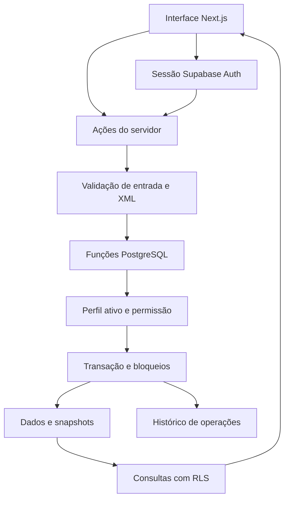

# Studio Gestão

ERP para **uma loja de móveis**, construído do zero em **TypeScript, Next.js e Supabase**, orientado pelo mapa funcional pesquisado do FoccoLOJAS. **Sem módulo fiscal e sem multitenancy.**

**Estado:** núcleo operacional inicial, com regras transacionais, interface e testes. O mapa completo contém 14 blocos e 115 funcionalidades; os recursos avançados continuam organizados no plano. A referência funcional não implica equivalência total com o produto original nem homologação da operação de uma loja real.

## O que existe nesta versão

| Área | Fluxo disponível |
| --- | --- |
| Acesso | Login Supabase, perfis ativos, administrador/comercial/operação/financeiro, permissões no banco e trilha de operações. |
| Cadastros | Clientes e fornecedores, criação e edição, vínculo com projetos e ambientes. |
| Projetos | Projeto → ambientes com fornecedor → versões de itens importados → múltiplos orçamentos. |
| XML | Layout configurável, UTF-8, prévia, seleção explícita de um ambiente de origem e um destino, identificação de conteúdo, versão imutável e deduplicação. |
| Orçamentos | Cópia das versões selecionadas, preços unitários, quantidades, custo e venda calculados em centavos no banco. |
| Contratos | Origem no orçamento, assinatura registrada, liberações comercial/financeira independentes e previsão a receber. |
| Revisão | Conferência da versão executiva, detecção de mudanças, bloqueio por diferença e aceite justificado de administrador. |
| Compras | Pedidos por fornecedor, previsão a pagar, registro local de envio, recebimento parcial, cancelamento com pré-condições e nova revisão para reemissão. |
| Estoque | Saldo físico, reserva explícita por contrato, disponibilidade, movimentos e consumo na entrega. |
| Agenda | Entrega/montagem, bloqueio de sobreposição do responsável, entrega das reservas e montagem após entrega integral. |
| Assistência | Abertura com ou sem contrato, ocorrências, quatro tipos de pagador, solução e encerramento. |
| Financeiro | Previsão distinta de título efetivo, contas a receber/pagar, baixa parcial, estorno integral de uma baixa e histórico preservado. |
| Gestão | Dashboard agregado, mapa completo com fontes, usuários e histórico de operações. |

O registro de assinatura é uma confirmação operacional; assinatura digital externa e modelos jurídicos personalizados não foram integrados. Marcar um pedido como enviado não transmite dados a uma fábrica. Baixas e estornos registram o controle interno, sem movimentar contas bancárias.

## Como executar

Requisito: **Node.js 22.13 ou superior**. O `package-lock.json` fixa as dependências utilizadas.

Abra a pasta do projeto extraída do arquivo entregue ou clonada do repositório quando o envio remoto estiver disponível:

```bash
cd system-test
npm ci
npm run demo
```

Abra **http://127.0.0.1:3000**.

### Demonstração local

`npm run demo` inicia o Next.js somente em `127.0.0.1`, com um banco PostgreSQL embutido em memória (PGlite), usuário fictício e as mesmas migrações/regras SQL do modo Supabase. Os dados desaparecem quando o servidor é encerrado. A faixa superior identifica o modo de demonstração.

Esse modo serve para experimentar e executar os testes de interface. `ERP_LOCAL_DEMO=1` é recusado quando `NODE_ENV=production`. Não há chave Supabase necessária na demonstração. PGlite fica em `devDependencies`; instalações de produção podem omiti-lo após o build.

### Conectar ao Supabase

1. Crie ou escolha um projeto Supabase e aplique as migrações versionadas, em ordem, com a CLI. O comando `db push` altera o projeto selecionado; confira o vínculo antes de executá-lo.

   ```bash
   npx supabase login
   npx supabase link --project-ref SEU_PROJECT_REF
   npx supabase db push
   ```

2. Cadastre o primeiro usuário em **Supabase Auth → Users**, com e-mail e senha de acesso. Esta versão usa login por senha. Convites por e-mail, recuperação de senha e MFA exigem completar o fluxo Auth correspondente antes de disponibilizá-los aos operadores.

3. Ative o primeiro administrador no SQL Editor. Substitua o e-mail abaixo pelo usuário que acabou de cadastrar. A migração cria os perfis inicialmente inativos.

   ```sql
   update public.profiles
   set name = 'Administrador da loja', role = 'admin', active = true
   where id = (
     select id from auth.users where email = 'SEU_EMAIL_REAL'
   );

   select p.id, p.name, p.role, p.active
   from public.profiles p
   join auth.users u on u.id = p.id
   where u.email = 'SEU_EMAIL_REAL';
   ```

   A consulta deve retornar exatamente o usuário correto com `admin` e `active=true`. Novos usuários podem ser ativados pelo administrador na tela Configurações.

4. Copie `.env.example` para `.env.local`. Preencha a URL, a **chave publicável** para a sessão e a **chave privada** somente no servidor para persistir o XML já interpretado. A chave privada nunca recebe o prefixo `NEXT_PUBLIC_` e não deve ser enviada em chat ou commit. As demais operações continuam usando a sessão do usuário e suas permissões no banco.

   ```dotenv
   NEXT_PUBLIC_SUPABASE_URL=https://SEU_PROJECT_REF.supabase.co
   NEXT_PUBLIC_SUPABASE_PUBLISHABLE_KEY=SUA_CHAVE_PUBLICAVEL
   SUPABASE_SECRET_KEY=SUA_CHAVE_PRIVADA_DO_SERVIDOR
   ```

5. Configure as URLs da aplicação em Supabase Auth e desabilite cadastros públicos se não forem necessários. Execute `npm run dev` e entre com o usuário criado.

Para Supabase local, a CLI e Docker devem estar instalados: `npx supabase start` e `npx supabase db reset`. O arquivo `supabase/tests/bootstrap.sql` é exclusivo do banco isolado de teste; **não deve ser aplicado no Supabase**.

O repositório não contém credenciais, projeto Supabase provisionado nem um deploy hospedado. O ambiente Supabase real precisa ser validado depois de conectar o projeto.

## Importação XML por ambiente

O caminho operacional é:

1. Cadastre cliente e fornecedor.
2. Crie um projeto e um ambiente, escolhendo o fornecedor.
3. Abra o ambiente e carregue o XML.
4. Confira o layout e o formato dos números; gere a prévia.
5. Selecione **um** ambiente do XML. Confira os códigos, unidades, quantidades e preços unitários.
6. Confirme explicitamente o projeto e o ambiente de destino.
7. Importe. A versão será registrada, preservando as anteriores. Repetir o mesmo conteúdo e mapeamento não cria outra versão.

O exemplo em [`examples/projeto-sintetico.xml`](examples/projeto-sintetico.xml) é **sintético**, e não um XML real do Promob. Há também um [layout alternativo](examples/mapeamento-alternativo.json). Os manuais oficiais descrevem layouts personalizados; a compatibilidade com o XML do seu exportador deve ser homologada usando arquivos reais.

Limites: UTF-8, 2 MiB, 100 ambientes e 5.000 itens por arquivo. DTD, entidades personalizadas, codificações incompatíveis e números ambíguos são recusados. Preços são unitários, com até duas casas; quantidades XML têm até três casas. O hash identifica o conteúdo UTF-8 após decodificação, com BOM removido. O XML e o recorte normalizado são preservados no PostgreSQL.

Detalhes, fontes, mapeamento e exemplos: [importação XML](docs/referencia/importacao-xml.md).

## Arquitetura e regras



- Uma única loja; nenhum `tenant_id` ou seletor de organizações.
- Quantidades decimais; dinheiro em centavos; totais calculados no banco.
- Orçamentos preservam cópias dos itens. Uma importação posterior não muda o contrato existente.
- Transações críticas usam funções RPC, não sequências independentes de gravação no navegador.
- A persistência do XML exige uma chamada confiável do servidor, após autenticação e interpretação dos bytes. Usuários da API não podem enviar diretamente um snapshot arbitrário. O banco revalida o perfil do ator informado pelo servidor. As [chaves privadas do Supabase](https://supabase.com/docs/guides/api/api-keys) ficam exclusivamente no backend.
- Recebimento, reserva, baixa, estorno e cancelamento usam chave de idempotência vinculada ao conteúdo e ao usuário.
- Tabelas operacionais não permitem gravação direta por usuários da aplicação. RLS limita consultas; funções verificam permissões próprias.
- Uma entrega consome todas as reservas ativas do contrato. Para entrega parcial, reserve apenas as quantidades que serão entregues naquele compromisso.
- A agenda usa a configuração inicial UTC−3. Nesta fatia, o responsável é o usuário que cria o compromisso.
- Títulos manuais nascem em aberto. Contratos e compras originam previsões, que precisam ser efetivadas antes da baixa.
- A previsão inicial usa vencimento em 30 dias; negociação de parcelas e calendário de cobrança pertencem à próxima fase.
- Cancelamento verifica os efeitos já executados e preserva registros; não apaga pagamentos nem movimentações históricas.

Contrato técnico das tabelas e RPCs: [arquitetura do banco](docs/arquitetura-banco.md).

## Verificação

```bash
npm run lint
npm run typecheck
npm test
npm run build

# Instalar um navegador uma vez, depois executar os fluxos:
npx playwright install chromium
npm run test:e2e
```

`npm run check` reúne lint, TypeScript, Vitest e build. Os testes de navegador iniciam uma demonstração local quando não há servidor na porta 3000. Para usar um Chromium já instalado, informe `PLAYWRIGHT_CHROMIUM_EXECUTABLE`.

Os testes de banco executam as migrações SQL e papéis/RLS em PGlite. Isso verifica as regras SQL nesse ambiente; não substitui testes de Auth, PostgREST, latência, concorrência entre sessões e configuração do projeto Supabase hospedado. O build usa Webpack, pois o Turbopack encontrou uma restrição de subprocessos no ambiente de execução utilizado.

Resultados executados: **120 testes de domínio/banco e 3 testes de navegador passaram**, assim como lint, TypeScript e build de produção. Evidências e limites: [validação](docs/validacao.md). Pendências de homologação e envio remoto: [estado atual](docs/estado-atual.md).

## Mapa completo e sequência de evolução

Comece por estes documentos:

- [Escopo e decisões](docs/escopo.md)
- [Mapa dos 14 blocos, regras e diagramas](docs/referencia/mapa-processos.md)
- [Ordem de implementação e critérios de aceite](docs/planos/ordem-de-implementacao.md)
- [Plano do núcleo inicial](docs/planos/2026-10-31-nucleo-erp.md)
- [Catálogo das 395 referências, com metadados e hashes](docs/referencia/fontes.json)
- [Estado atual e ponto de retomada](docs/estado-atual.md)

Permanecem nas próximas fases: negociação de descontos/parcelas/comissões, contratos complementares, demonstração e devolução de avulsos, compras avulsas e de assistência, inventário/transferências, equipes/capacidade/checklists, reagendamento, automações Enterprise, empreendimentos, integrações com fábricas/assinatura/bancos, ETL e indicadores avançados. O mapa também preserva o bloco Marketing no escopo efetivamente documentado.

A interface foi construída para estes fluxos, com identidade visual própria. A fidelidade visual ao FoccoLOJAS exige referências das telas reais e validação separada.

## Organização do código

```text
src/app/                 Rotas, telas e ações do servidor
src/components/          Componentes de interface e formulários
src/lib/imports/         Parser XML, mapeamento e identificação
src/lib/server/          Sessão, acesso ao banco e demonstração local
src/lib/process-map.ts   Mapa rastreável utilizado pela interface
supabase/migrations/     Schema, permissões e transações versionadas
supabase/tests/          Bootstrap exclusivo dos testes isolados
tests/                  Casos automatizados de domínio, banco e navegador
examples/               XMLs sintéticos e mapeamento alternativo
docs/                   Escopo, referência, planos, estado e evidências
```

O `AGENTS.md` mínimo é gerado pelo próprio Next.js e aponta para a documentação da versão instalada. O projeto não utiliza GitHub Actions.
