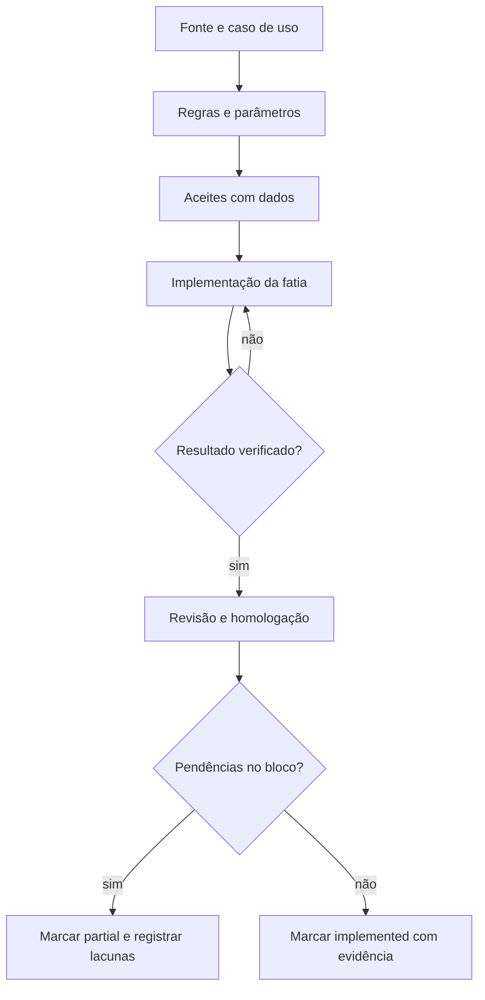

# Ordem de implementação e critérios de avanço

## Objetivo e método

Entregar o escopo de uma loja em TypeScript/Next.js/Tailwind/Supabase, preservando os 14 blocos não fiscais do [mapa](../referencia/mapa-processos.md). A sequência abaixo é um **plano de implementação**, não um relatório de tarefas concluídas. O estado verificável de cada bloco é registrado em [process-map.ts](../../src/lib/process-map.ts).

Cada fatia deve fechar uma operação com interface, regra, persistência, autorização, efeitos e auditoria pertinentes. Ao contrário de uma lista de telas, a conclusão exige resultado observado. Não é necessário esperar todas as funções de um módulo para entregar uma fatia útil; o bloco permanece `partial` enquanto houver cobertura declarada pendente.

## Fases

| Fase | Blocos principais | Entrega concreta | Dependência e critério para avançar |
| --- | --- | --- | --- |
| 1 | 13 Sistema e Avançado | Estrutura da aplicação, identidade, configuração de uma loja, permissões e trilha de auditoria. | Operação autorizada persiste; a mesma ação sem permissão é recusada. Identificar Supabase conectado versus demonstração. |
| 2 | 01 Clientes, 02 Projetos; contrato de arquivo do 14 | Cliente → projeto → ambiente/itens → importação sintética → orçamento reproduzível. | AC-01 e AC-02; origem e versão do arquivo conhecidas; nenhum anúncio de compatibilidade com XML real. |
| 3 | 03 Contratos, 09 Financeiro básico | Orçamento → contrato → decisões de aprovação → obrigação → baixa parcial/estorno. | AC-03 e AC-09; repetir uma requisição não duplica contrato ou baixa; cancelar não ignora pagamento existente. |
| 4 | 04 Revisão, 05 Compras | Revisão por ambiente e pedido por fornecedor; compra avulsa continua possível. | AC-04 e AC-05; gates dependem dos parâmetros; estados de envio/atendimento são distintos. |
| 5 | 06 Estoque, 07 Agenda/execução | Recebimento parcial → saldo → reserva → entrega/montagem aplicável. | AC-06 e AC-07; quantidades conciliadas, reserva concorrente verificada e cancelamento justificado. |
| 6 | 08 Assistência, 11 Indicadores; evolução do 09 | Ocorrências, pagador, solução com/sem compra; indicadores calculados do fluxo real. | AC-08 e AC-11; assistência sem contrato não é proibida por suposição; totais explicam sua origem. |
| 7 | 12 Enterprise, 14 Integrações, 15 Marketing; avançados de todos | Conectores reais, automações, comissões avançadas, BI/ETL, layouts e variantes de venda. | AC-12, AC-14, AC-15 e os demais aceites específicos. Cada conector exige contrato técnico, permissão, teste e recuperação de falhas. |

As fases organizam dependências de entrega, não regras universais de operação. Uma compra avulsa não precisa esperar contrato/revisão na interface. A infraestrutura necessária à importação sintética está na fase 2, mesmo que o conjunto de integrações produtivas seja fase 7. Financeiro e auditoria acompanham toda a execução, não são adicionados apenas ao final.

## Fluxo de trabalho por fatia

1. **Fixar a referência:** apontar IDs/URLs, versão quando disponível e parâmetros relevantes. Usar [fontes.json](../referencia/fontes.json); não copiar os corpos dos manuais para o repositório.
2. **Escrever o caso:** ator, entrada, estado inicial, ação, saída, efeitos em outros módulos e exceções. Distinguir comportamento documentado de decisão nova.
3. **Definir aceites:** incluir resultado esperado com números quando houver saldo, quantidade ou valor. Resolver conflitos materiais do manual para a variante escolhida.
4. **Implementar uma fatia:** conectar tela, regras, persistência e autorização. Função planejada fica identificada; nunca criar botão de sucesso para operação inexistente.
5. **Verificar o risco concreto:** caminho normal, erro relevante, permissão e repetição; concorrência e reversão onde houver saldo ou obrigação. Não testar apenas se a tela abriu.
6. **Revisar e registrar:** conferir a mudança contra fonte e escopo, registrar ambiente/comando/resultado observado e atualizar somente o status justificável.

## Exemplos de aceite que atravessam módulos

| Caso | Preparação | Ação e resultado esperado | Evidência mínima |
| --- | --- | --- | --- |
| E2E-01 Venda planejada simples | Cliente sintético, ambiente com subtotal R$ 250,00 e desconto proposto de 10%, sem outras despesas. | Total R$ 225,00; contrato mantém a versão aprovada; revisão e compra respeitam os gates configurados. | IDs ligados da origem ao contrato/pedido; total conferido; ator e transições registrados. |
| E2E-02 Atendimento parcial | Pedido de 10 unidades. | Receber 4 e depois 6 preserva saldo pendente, estoque e histórico. Repetir a primeira requisição não soma 4 de novo. | Contagem final e movimentos por recebimento; resposta da repetição registrada. |
| E2E-03 Reserva concorrente | Saldo disponível 6, estoque negativo bloqueado. | Duas solicitações concorrentes de 5 resultam em no máximo uma reserva aceita. | Resultado de ambas as solicitações e saldo final; não basta simular dois cliques sequenciais. |
| E2E-04 Baixa e estorno | Título de R$ 225,00 em aberto. | Receber R$ 100,00 deixa R$ 125,00; repetir não duplica; estornar restitui o saldo com histórico. | Título, baixa, chave de repetição e evento de estorno. |
| E2E-05 Assistência sem reposição | Cliente existente sem contrato, ocorrência resolvível por visita. | Abrir, agendar se necessário, resolver e concluir sem impor compra. | Ocorrência e solução vinculadas; nenhuma compra artificial criada. |
| E2E-06 Acesso negado | Usuário sem alçada de aprovação. | Requisição direta para aprovar é recusada; contrato, títulos e auditoria de negócio não indicam aprovação bem-sucedida. | Resposta negativa e consulta posterior das entidades; auditoria de tentativa se prevista. |
| E2E-07 Indicador rastreável | Dois contratos válidos de R$ 225,00 e R$ 100,00 no período. | Indicador mostra R$ 325,00 e o detalhe identifica a base; cancelamento segue a fórmula declarada. | Consulta/filtro, fórmula e registros que compõem o total. |

Esses números são fixtures propostas. O implementador deve registrar o contrato escolhido, incluindo precisão e estado de origem. Nenhum caso desta tabela está marcado como executado por sua mera existência no plano.

## Recursos avançados que não podem sumir do backlog

- **Comercial:** visitas, carteira, especificadores, fidelidade, vários cenários, formação de preço, despesas, alçadas, itens especiais, demonstração, venda futura e devolução comercial.
- **Contratos/revisão:** modelos/cláusulas, assinatura externa, checklists, complementos, snapshots, comparação, divisão/unificação e reabertura controlada.
- **Compras/estoque:** catálogos, máscaras, condições, consulta de parcelas, fornecedor integrado, volumes, locais, conversões, inventário, períodos e custo.
- **Execução/assistência:** equipes, habilitações, checklists, check-in/out, questionários, despesas, comissões, transporte e fluxos por pagador.
- **Financeiro/gestão:** previsões, efetivação, negociações, caixa, portadores, centros de custo, juros, rateios, cheques, TEF, políticas de comissão, indicadores e ETL.
- **Enterprise/integrações/marketing:** pipelines, matriz, gatilhos, comunicação, empreendimentos, aplicativos, Promob, fornecedores, e-commerce, DocSeguro, PipeRun e compra de itens de marketing, conforme evidência e contrato disponíveis.

Para cada item, abrir uma fatia verificável com fonte, dependência e aceite. Fiscal, hierarquia de múltiplas lojas e multitenancy permanecem excluídos; não entrarão pela implementação de um conector ou relatório.

## Arquitetura: decisões pelo caso, não por falsa oposição

Frontend, backend e banco são responsabilidades diferentes. A stack aprovada permite usar serviços do Supabase e funções/RPC do PostgreSQL para transações, com código de servidor quando o caso exigir. A escolha deve considerar autorização, atomicidade, tratamento de falhas, integrações e capacidade de testar. Não colocar uma regra crítica apenas no navegador por conveniência.

Integração externa de longa duração exige contrato de estados e recuperação: tentativa, resposta, correlação, repetição e falha. Não declarar uma conexão ativa apenas porque há URL ou variável de ambiente. Nenhuma credencial deve aparecer em catálogo, commit, log ou seed.

## Verificação visual

O frontend será próprio e o objetivo de proximidade visual deve ser avaliado separadamente do aceite funcional. Selecionar uma listagem rica, um detalhe com abas e uma ação com validação, observando navegação, estados vazios, erro, carregamento e responsividade. Screenshots isolados do help não cobrem todas as interações.

Antes de usar “igual ao Focco” ou “100%”, registrar quais telas/estados foram comparados, quais referências foram fornecidas e quais diferenças permanecem. Até lá, usar “interface baseada no mapa funcional”.

## Registro de conclusão e retomada

Usar o registro do projeto já adotado pela equipe; não criar AGENTS.md ou automação de CI por rotina. Em cada conclusão, anotar:

- Objetivo e caso de aceite da fatia.
- Arquivos alterados e vínculo com a fonte/requisito.
- Verificação realmente executada, ambiente e resultado.
- Limitações, falhas e funções ainda planejadas.
- Status justificado do bloco e próxima operação a completar.

A documentação desta referência foi produzida pela IA a partir da pesquisa consolidada. A implementação ocorre em frentes paralelas; a validação dos módulos cabe à revisão da entrega real, não à contagem de documentos ou de telas.
