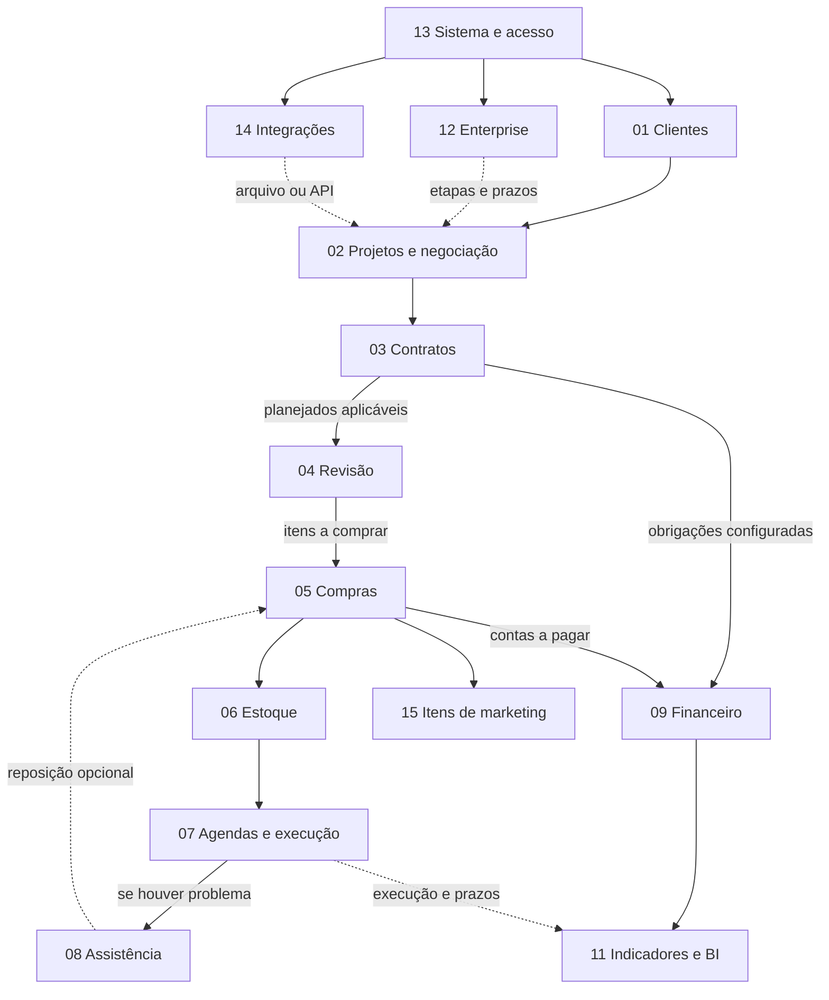
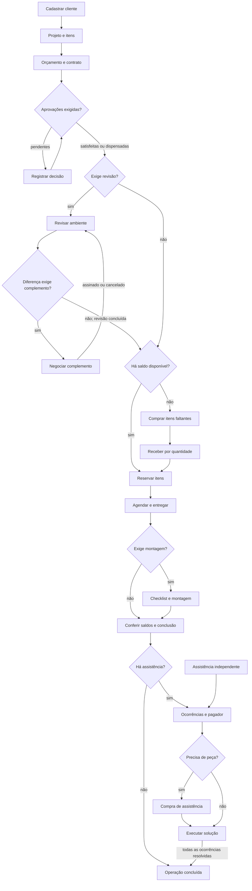

# Mapa de processos e referência funcional

## Como ler este documento

Este projeto usa a documentação pública do **FoccoLOJAS** como referência funcional e cria código próprio em **TypeScript, Next.js, Tailwind CSS e Supabase**. O escopo autorizado é **uma única loja, sem fiscal e sem multitenancy**. A pesquisa anterior sobre Laravel/Filament não define esta implementação.

O mapa preserva todos os **14 blocos não fiscais**, inclusive os recursos avançados ainda planejados. Os IDs 01–09 e 11–15 são os IDs da pesquisa; o 10 corresponde ao Fiscal e foi excluído da implementação. A divisão é didática: não reproduz a contagem ou a estrutura exata do menu proprietário.

Cada trecho distingue três coisas:

- **Evidência:** comportamento descrito na fonte pública, sujeito à versão e configuração.
- **Proposta:** comportamento e caso de aceite do novo sistema; exige implementação e verificação.
- **Lacuna:** informação ainda não confirmada; não pode virar uma funcionalidade anunciada como pronta.

O status inicial do catálogo de módulos é `planned`. Uma fatia verificada pode levar um bloco a `partial`; só usar `implemented` quando todas as funcionalidades declaradas daquele bloco tiverem evidência de conclusão. O arquivo [process-map.ts](../../src/lib/process-map.ts) é a lista consumível pela aplicação. A existência de uma tela ou deste documento não prova persistência, permissão ou fluxo completo.

## Visão dos 14 blocos

As dependências indicam compartilhamento de dados, serviços ou efeitos. Não significam que todo caso de uso precisa passar por todos os blocos: compra avulsa não exige contrato, assistência pode dispensar compra e estoque já disponível pode dispensar novo pedido.

| ID | Bloco | Grupo | Fase inicial | Conexões/dependências |
| --- | --- | --- | --- | --- |
| 01 | Clientes e relacionamento | Vender | 2 | 13 |
| 02 | Projetos e negociação | Vender | 2 | 01, 13 |
| 03 | Contratos e aprovações | Vender | 3 | 02, 09, 13 |
| 04 | Revisão técnica | Executar | 4 | 02, 03, 13 |
| 05 | Compras e fornecedores | Executar | 4 | 04, 09, 13 |
| 06 | Estoque e recebimento | Executar | 5 | 05, 13 |
| 07 | Agendas, entrega e montagem | Executar | 5 | 01, 03, 06, 13 |
| 08 | Assistência técnica | Executar | 6 | 01, 05, 07, 09, 13 |
| 09 | Financeiro e comissões | Controlar | 3 | 13 |
| 11 | Indicadores e BI | Controlar | 6 | 03, 05, 06, 07, 08, 09 |
| 12 | Enterprise e automações | Conectar | 7 | 01, 02, 03, 07, 13 |
| 13 | Sistema e Avançado | Conectar | 1 | Base |
| 14 | Integrações e aplicativos | Conectar | 7 | 02, 03, 05, 09, 13 |
| 15 | Marketing | Conectar | 7 | 05, 13 |

### Conexões entre módulos

O desenho representa relações funcionais, com condições nas ramificações. Financeiro, identidade e integrações participam de mais operações do que as setas selecionadas.

### Execução completa com alternativas

Esta é uma **proposta de fluxo verificável** derivada da referência. Liberação financeira antes da revisão, compra e entrega prévia à montagem são condições configuradas, não gates universais. Abertura de assistência também pode ocorrer independentemente de venda anterior.

Financeiro não começa apenas no final do desenho: contratos, compras, despesas e assistências podem gerar previsões ou títulos em momentos distintos. Toda mutação relevante deve registrar a trilha proposta de auditoria e tratar repetição, falha e reversão. Esse requisito do novo sistema não atribui ao FoccoLOJAS uma garantia de histórico imutável.

## Módulos, regras e casos de aceite

Os exemplos abaixo usam dados sintéticos e representam **aceites propostos, ainda não resultados de testes**. Valores de arredondamento, estados e permissões devem ser ajustados ao contrato real de implementação e registrados antes de homologar.

### 01. Clientes e relacionamento

Identificar clientes, contatos, responsáveis e oportunidades de uma única loja.

**Entradas:** Dados de contato, origem e responsável pelo atendimento.

**Saídas:** Cliente identificável, projetos vinculados e histórico de ações.

**Núcleo da primeira sequência de entregas — a implementar e verificar:**

- Cadastro e edição de cliente com identificação e contatos.
- Vínculo do cliente com projetos e histórico operacional.

**Cobertura avançada preservada no plano:**

- Visitas, prospecção e carteira.
- Especificadores, parceiros e indicações.
- Fidelidade por cadastro e origem do cliente.
- Pipeline comercial e previsão de fechamento.

**Evidência que altera o desenho:** A classificação do cliente e a fidelidade do especificador são controles diferentes; os gatilhos do pipeline dependem da configuração.

**Aceite proposto:** AC-01: cadastrar um cliente de demonstração e dois projetos; ambos devem apontar para o mesmo cliente e a alteração de contato não pode criar um terceiro cadastro.

**Lacunas e limites:**

- Definir a política de duplicidade de CPF/CNPJ e os campos obrigatórios da loja.
- Carteira, fidelidade e gatilhos avançados permanecem planejados.

**Fontes oficiais selecionadas:**

- [31114802885649 — FoccoLOJAS - Programas - Comercial - Vendas - Clientes](https://suporte.promob.com/hc/pt-br/articles/31114802885649-FoccoLOJAS-Programas-Comercial-Vendas-Clientes)
- [31115312153489 — FoccoLOJAS - Ficha Completa de Cliente](https://suporte.promob.com/hc/pt-br/articles/31115312153489-FoccoLOJAS-Ficha-Completa-de-Cliente)
- [31115328556305 — FoccoLOJAS - Programas - Comercial - Vendas - Especificadores](https://suporte.promob.com/hc/pt-br/articles/31115328556305-FoccoLOJAS-Programas-Comercial-Vendas-Especificadores)
- [31114213483537 — FoccoLOJAS - Programas - Avançado - Comercial - Níveis de Fidelidade](https://suporte.promob.com/hc/pt-br/articles/31114213483537-FoccoLOJAS-Programas-Avan%C3%A7ado-Comercial-N%C3%ADveis-de-Fidelidade)
- [49192062260881 — FoccoLOJAS - Pipeline | Painel de Projetos](https://suporte.promob.com/hc/pt-br/articles/49192062260881-FoccoLOJAS-Pipeline-Painel-de-Projetos)

### 02. Projetos e negociação

Organizar projetos, ambientes, itens e versões de orçamento, com importação XML verificável.

**Entradas:** Cliente, ambientes, itens, arquivo do formato aceito e condições comerciais.

**Saídas:** Orçamento versionado, total reproduzível e origem de cada item importado.

**Núcleo da primeira sequência de entregas — a implementar e verificar:**

- Projeto vinculado ao cliente.
- Ambientes e itens com quantidade e preço.
- Importação de XML sintético com prévia e erros.
- Orçamento com totais e desconto explícitos.

**Cobertura avançada preservada no plano:**

- Vários cenários e versões de orçamento.
- Itens avulsos e venda simplificada.
- Tabelas e formação de preço por fornecedor.
- Despesas, juros, envolvidos e comissionados.
- Itens especiais e alçadas de desconto.
- Demonstração, venda futura e devolução comercial.

**Evidência que altera o desenho:** O projeto pode ter vários orçamentos. Layouts de importação são específicos; importação XML e integração API Promob são caminhos diferentes.

**Aceite proposto:** AC-02: importar uma amostra sintética com 2 unidades a R$ 100,00 e 1 a R$ 50,00; o subtotal deve ser R$ 250,00. No cenário proposto de desconto de 10% sem outras despesas, o total deve ser R$ 225,00. Quantidade inválida deve impedir a confirmação sem gravar metade da operação.

**Lacunas e limites:**

- O XML inicial é uma fixture sintética; compatibilidade com exportação real depende de arquivos fornecidos e validados.
- Decidir arredondamento, atualização de versões e reimportação antes de aceitar XML real.
- Política de crédito/reembolso na devolução comercial precisa ser definida para este produto.

**Fontes oficiais selecionadas:**

- [31114181027089 — FoccoLOJAS - Programas - Comercial - Vendas - Projetos](https://suporte.promob.com/hc/pt-br/articles/31114181027089-FoccoLOJAS-Programas-Comercial-Vendas-Projetos)
- [31112331228689 — FoccoLojas - Programas - Comercial - Gestão - Tabela de Preços de Loja](https://suporte.promob.com/hc/pt-br/articles/31112331228689-FoccoLojas-Programas-Comercial-Gest%C3%A3o-Tabela-de-Pre%C3%A7os-de-Loja)
- [31114194767761 — FoccoLOJAS - Programas - Comercial - Financeiro - Formação de Preço](https://suporte.promob.com/hc/pt-br/articles/31114194767761-FoccoLOJAS-Programas-Comercial-Financeiro-Forma%C3%A7%C3%A3o-de-Pre%C3%A7o)
- [31113830062609 — FoccoLOJAS - Programas - Avançado - Comercial - Layout de Importação](https://suporte.promob.com/hc/pt-br/articles/31113830062609-FoccoLOJAS-Programas-Avan%C3%A7ado-Comercial-Layout-de-Importa%C3%A7%C3%A3o)
- [49360032858385 — FoccoLOJAS - Programas - Comercial - Gestão - Solicitações de Itens Especiais](https://suporte.promob.com/hc/pt-br/articles/49360032858385-FoccoLOJAS-Programas-Comercial-Gest%C3%A3o-Solicita%C3%A7%C3%B5es-de-Itens-Especiais)
- [31115308739473 — FoccoLOJAS - Programas - Comercial - Financeiro - Limites de Desconto](https://suporte.promob.com/hc/pt-br/articles/31115308739473-FoccoLOJAS-Programas-Comercial-Financeiro-Limites-de-Desconto)
- [31113835761041 — FoccoLOJAS - Processos - Devolução](https://suporte.promob.com/hc/pt-br/articles/31113835761041-FoccoLOJAS-Processos-Devolu%C3%A7%C3%A3o)

### 03. Contratos e aprovações

Formalizar o orçamento aprovado e registrar decisões comerciais e financeiras com responsáveis.

**Entradas:** Versão de orçamento, condições, decisão autorizada e parâmetros de liberação.

**Saídas:** Contrato vinculado à origem, aprovação rastreável e obrigações financeiras quando configuradas.

**Núcleo da primeira sequência de entregas — a implementar e verificar:**

- Contrato originado do orçamento escolhido.
- Decisão de aprovação com ator, data e motivo.
- Estados de assinatura e liberação separados.
- Cancelamento com análise dos vínculos.

**Cobertura avançada preservada no plano:**

- Cláusulas, modelos e impressão de documentos.
- Assinatura externa pelo DocSeguro.
- Checklists e aprovações por alçada.
- Contrato complementar ligado à revisão.
- Distrato e tratamento de obrigações pendentes.

**Evidência que altera o desenho:** Assinatura, liberação comercial e liberação financeira são controles distintos. A liberação financeira pode ser automática; exigir essa liberação para revisar é opcional.

**Aceite proposto:** AC-03: aprovar o orçamento de R$ 225,00 e repetir a mesma solicitação; deve existir um contrato e um único efeito financeiro. Usuário sem permissão deve ser recusado. Se o contrato já tiver pagamento, cancelar deve exigir o tratamento desse vínculo.

**Lacunas e limites:**

- Fixar os parâmetros da loja que tornam cada liberação obrigatória, automática ou dispensada.
- Assinatura interna de demonstração não equivale a assinatura eletrônica validada por provedor.

**Fontes oficiais selecionadas:**

- [31113939460753 — FoccoLOJAS - Programas - Comercial - Vendas - Contratos](https://suporte.promob.com/hc/pt-br/articles/31113939460753-FoccoLOJAS-Programas-Comercial-Vendas-Contratos)
- [31114803810065 — FoccoLOJAS - Programas - Comercial - Vendas - Assinatura Eletrônica de Documentos](https://suporte.promob.com/hc/pt-br/articles/31114803810065-FoccoLOJAS-Programas-Comercial-Vendas-Assinatura-Eletr%C3%B4nica-de-Documentos)
- [31114261462289 — FoccoLOJAS - Programas - Sistema - Configurações - Financeiro - Configurações do Financeiro](https://suporte.promob.com/hc/pt-br/articles/31114261462289-FoccoLOJAS-Programas-Sistema-Configura%C3%A7%C3%B5es-Financeiro-Configura%C3%A7%C3%B5es-do-Financeiro)
- [31112431320977 — FoccoLojas - Processos - Comercial - Venda - Contrato - Cancelamento do Contrato com Pré Pedidos](https://suporte.promob.com/hc/pt-br/articles/31112431320977-FoccoLojas-Processos-Comercial-Venda-Contrato-Cancelamento-do-Contrato-com-Pr%C3%A9-Pedidos)
- [31115322015121 — FoccoLOJAS - Programas - Financeiro - Gestão - Liberação Financeira](https://suporte.promob.com/hc/pt-br/articles/31115322015121-FoccoLOJAS-Programas-Financeiro-Gest%C3%A3o-Libera%C3%A7%C3%A3o-Financeira)

### 04. Revisão técnica

Revisar cada ambiente, comparar o vendido ao revisado e controlar diferenças antes da compra aplicável.

**Entradas:** Ambiente contratado, versão do projeto, itens revisados e checklist aplicável.

**Saídas:** Revisão concluída ou pendência explícita, diferenças registradas e itens elegíveis à compra.

**Núcleo da primeira sequência de entregas — a implementar e verificar:**

- Revisor e situação por ambiente.
- Conferência dos itens e valores.
- Registro de conclusão e histórico.

**Cobertura avançada preservada no plano:**

- Comparação de snapshots e reativação de versões.
- Negociação e contratos complementares.
- Liberação de diferenças por alçada.
- Divisão, unificação, cancelamento e reversão de ambientes.
- Revisão inicial/executiva de venda futura.
- Integração Promob e migração de projetos legados.

**Evidência que altera o desenho:** A negociação da diferença pode bloquear alterações até assinatura ou cancelamento do complemento. Dividir exige percentuais totalizando 100%; unificar exige o mesmo contrato. Avulsos não devem herdar indiscriminadamente a revisão de planejados.

**Aceite proposto:** AC-04: revisar um ambiente e registrar diferença de valor; se a política exigir complemento, a conclusão não pode contornar a pendência. Em uma futura divisão de 60% e 40%, a soma das partes deve preservar o total; 60% e 50% deve ser rejeitado.

**Lacunas e limites:**

- Concluída Parcial aparece em ações do help, mas não em toda enumeração de estados; confirmar o comportamento antes de reproduzir.
- Não derivar estrutura interna do banco apenas do nome dos campos do help.

**Fontes oficiais selecionadas:**

- [40799016253841 — FoccoLOJAS - Pós-Vendas - Revisão de Ambientes API](https://suporte.promob.com/hc/pt-br/articles/40799016253841-FoccoLOJAS-P%C3%B3s-Vendas-Revis%C3%A3o-de-Ambientes-API)
- [41070712550801 — FoccoLOJAS - Pós-Venda - Revisões de Projeto - Importação XML](https://suporte.promob.com/hc/pt-br/articles/41070712550801-FoccoLOJAS-P%C3%B3s-Venda-Revis%C3%B5es-de-Projeto-Importa%C3%A7%C3%A3o-XML)
- [31114577637009 — FoccoLOJAS - Programas - Pós-Venda - Revisões - Revisão de Ambientes](https://suporte.promob.com/hc/pt-br/articles/31114577637009-FoccoLOJAS-Programas-P%C3%B3s-Venda-Revis%C3%B5es-Revis%C3%A3o-de-Ambientes)
- [31114561429905 — FoccoLOJAS - Programas - Pós-Venda - Revisões - Manutenção de Ambientes](https://suporte.promob.com/hc/pt-br/articles/31114561429905-FoccoLOJAS-Programas-P%C3%B3s-Venda-Revis%C3%B5es-Manuten%C3%A7%C3%A3o-de-Ambientes)
- [31112258334737 — FoccoLOJAS - Comparar versões da Revisão de Ambientes - Planejados](https://suporte.promob.com/hc/pt-br/articles/31112258334737-FoccoLOJAS-Comparar-vers%C3%B5es-da-Revis%C3%A3o-de-Ambientes-Planejados)

### 05. Compras e fornecedores

Registrar fornecedores e pedidos, acompanhar envio e receber quantidades com estados separados.

**Entradas:** Necessidade de compra, fornecedor, itens, valores e condições.

**Saídas:** Pedido rastreável, atendimento parcial/total, recebimentos e previsões ou títulos vinculados.

**Núcleo da primeira sequência de entregas — a implementar e verificar:**

- Fornecedor e itens do pedido.
- Pedido manual ou originado da revisão.
- Envio registrado e recebimento parcial.
- Vínculo com obrigação a pagar quando configurado.

**Cobertura avançada preservada no plano:**

- Catálogos, máscaras e tabelas de compra.
- Alçadas, metas e condições de pagamento.
- Pedidos por assistência, venda futura e compra avulsa.
- Consulta de status e parcelas da fábrica.
- Cancelamento e reabertura conforme origem.
- Supplier Portal, FoccoERP e Web Service.

**Evidência que altera o desenho:** Compra avulsa e assistência podem originar pedidos sem a mesma revisão de um planejado. Supplier Portal tem fluxo próprio. Consultar parcelas na fábrica pode recriar previsões em aberto; não é apenas uma leitura de status.

**Aceite proposto:** AC-05: emitir um pedido de 10 unidades, receber 4 e depois 6; os totais devem indicar atendimento parcial e total. Repetir o primeiro recebimento com a mesma chave não pode acrescentar outras 4 unidades.

**Lacunas e limites:**

- Conector externo depende de contrato técnico, credenciais autorizadas e ambiente de teste.
- Definir efeitos do cancelamento quando há recebimento, reserva ou pagamento; não apagar tudo em cascata.

**Fontes oficiais selecionadas:**

- [31113817118097 — FoccoLOJAS - Processos - Processos de Compras](https://suporte.promob.com/hc/pt-br/articles/31113817118097-FoccoLOJAS-Processos-Processos-de-Compras)
- [31114390670865 — FoccoLOJAS - Programas - Compras - Pedidos de Compra - Geração e Envio](https://suporte.promob.com/hc/pt-br/articles/31114390670865-FoccoLOJAS-Programas-Compras-Pedidos-de-Compra-Gera%C3%A7%C3%A3o-e-Envio)
- [31114383417873 — FoccoLOJAS - Programas - Compras - Pedidos de Compra - Pedido de Compra](https://suporte.promob.com/hc/pt-br/articles/31114383417873-FoccoLOJAS-Programas-Compras-Pedidos-de-Compra-Pedido-de-Compra)
- [31112877701137 — FoccoLOJAS - Processos - Integração com o Supplier Portal](https://suporte.promob.com/hc/pt-br/articles/31112877701137-FoccoLOJAS-Processos-Integra%C3%A7%C3%A3o-com-o-Supplier-Portal)
- [31114389541393 — FoccoLOJAS - Programas - Compras - Pedidos de Compra - Atendimento](https://suporte.promob.com/hc/pt-br/articles/31114389541393-FoccoLOJAS-Programas-Compras-Pedidos-de-Compra-Atendimento)
- [51677040693265 — FoccoLOJAS - Programas - Compras - Pedidos de Compra – Cancelar Pedido de Compra](https://suporte.promob.com/hc/pt-br/articles/51677040693265-FoccoLOJAS-Programas-Compras-Pedidos-de-Compra-Cancelar-Pedido-de-Compra)
- [31114561282705 — FoccoLOJAS - Programas - Pós-Venda - Entrega e Montagem - Consultar Pedidos na Fábrica](https://suporte.promob.com/hc/pt-br/articles/31114561282705-FoccoLOJAS-Programas-P%C3%B3s-Venda-Entrega-e-Montagem-Consultar-Pedidos-na-F%C3%A1brica)

### 06. Estoque e recebimento

Controlar saldo, movimentos, reservas e recebimentos físicos de uma única loja.

**Entradas:** Recebimentos, ajustes autorizados, reservas e saídas operacionais.

**Saídas:** Saldo físico, reservado e disponível separados, com movimentos vinculados à origem.

**Núcleo da primeira sequência de entregas — a implementar e verificar:**

- Entrada operacional por recebimento.
- Saldo por produto/local.
- Histórico de movimentos.
- Reserva e liberação de quantidade.

**Cobertura avançada preservada no plano:**

- Conferência de volumes e etiquetas.
- Vários almoxarifados dentro da mesma loja.
- Conversão de unidades e máscaras.
- Inventário, ajustes e fechamento/reabertura de períodos.
- Controle de estoque negativo e fracionado.
- Transferências internas entre locais.

**Evidência que altera o desenho:** Atendimento do pedido, entrada em estoque e reserva são estados diferentes. No produto de referência, movimentos dependem de parâmetros do item/documento. Neste escopo, a entrada é operacional e não emite ou importa documento fiscal.

**Aceite proposto:** AC-06: com 10 unidades físicas e 4 reservadas, o disponível deve ser 6. Com bloqueio de saldo negativo, duas reservas concorrentes de 5 não podem ser ambas aceitas. Liberar a reserva deve restituir disponibilidade sem criar entrada física.

**Lacunas e limites:**

- Confirmar unidade de medida, custo e regra de arredondamento por produto.
- Inventário fechado, custo médio e conversões avançadas permanecem planejados até verificação específica.

**Fontes oficiais selecionadas:**

- [31113765831313 — FoccoLOJAS - Processos - Processo de Movimentação de Estoque](https://suporte.promob.com/hc/pt-br/articles/31113765831313-FoccoLOJAS-Processos-Processo-de-Movimenta%C3%A7%C3%A3o-de-Estoque)
- [33774366330769 — FoccoLOJAS - Programas – Compras - Estoque - Reservas de Estoque](https://suporte.promob.com/hc/pt-br/articles/33774366330769-FoccoLOJAS-Programas-Compras-Estoque-Reservas-de-Estoque)
- [31114389719569 — FoccoLOJAS - Programas - Compras - Estoque - Movimentação](https://suporte.promob.com/hc/pt-br/articles/31114389719569-FoccoLOJAS-Programas-Compras-Estoque-Movimenta%C3%A7%C3%A3o)
- [31114349053073 — FoccoLOJAS - Programas - Compras](https://suporte.promob.com/hc/pt-br/articles/31114349053073-FoccoLOJAS-Programas-Compras)
- [31114389294353 — FoccoLOJAS - Programas - Compras - Estoque - Almoxarifados](https://suporte.promob.com/hc/pt-br/articles/31114389294353-FoccoLOJAS-Programas-Compras-Estoque-Almoxarifados)
- [31114388481297 — FoccoLOJAS - Programas - Compras - Cadastros Gerais - Itens Cadastro Completo](https://suporte.promob.com/hc/pt-br/articles/31114388481297-FoccoLOJAS-Programas-Compras-Cadastros-Gerais-Itens-Cadastro-Completo)

### 07. Agendas, entrega e montagem

Agendar entrega, montagem, medição e serviços e registrar execução, responsáveis e pendências.

**Entradas:** Disponibilidade de itens e pessoas, tipo de serviço e prazo acordado.

**Saídas:** Agendamento, execução ou pendência registrada e evento apto a gerar efeitos configurados.

**Núcleo da primeira sequência de entregas — a implementar e verificar:**

- Compromisso vinculado ao cliente/ambiente.
- Responsável, data e situação.
- Conclusão ou cancelamento com justificativa.
- Consulta da agenda e histórico.

**Cobertura avançada preservada no plano:**

- Equipes, habilitações e permissões de agenda.
- Checklists condicionais de entrega e montagem.
- Check-in, check-out e questionários.
- Despesas e geração de comissão por execução.
- Controle específico de entrega de avulsos.
- Reagendamento e acompanhamento de prazos.

**Evidência que altera o desenho:** A montagem verifica entrega quando existe agenda de entrega, além dos checklists exigidos. Cancelamento de entrega/montagem exige justificativa. Não há evidência suficiente para presumir otimização automática de rotas.

**Aceite proposto:** AC-07: quando uma agenda de montagem depender de entrega pendente, concluir deve ser bloqueado; após entrega e checklist, deve ser permitido. Cancelar deve registrar motivo sem apagar o compromisso.

**Lacunas e limites:**

- Definir quais serviços exigem checklist, disponibilidade e conclusão prévia.
- Aplicativo nativo, geolocalização e roteirização não estão comprovados pela simples existência da agenda web.

**Fontes oficiais selecionadas:**

- [31114334539793 — FoccoLOJAS - Programas - Agendas](https://suporte.promob.com/hc/pt-br/articles/31114334539793-FoccoLOJAS-Programas-Agendas)
- [31114577074321 — FoccoLOJAS - Programas - Pós-Venda - Entrega e Montagem](https://suporte.promob.com/hc/pt-br/articles/31114577074321-FoccoLOJAS-Programas-P%C3%B3s-Venda-Entrega-e-Montagem)
- [40392771438737 — FoccoLOJAS - Pós-Venda - Como criar e concluir Agendas de Entrega e Montagem](https://suporte.promob.com/hc/pt-br/articles/40392771438737-FoccoLOJAS-P%C3%B3s-Venda-Como-criar-e-concluir-Agendas-de-Entrega-e-Montagem)
- [31114456614033 — FoccoLOJAS - Programas - Pós Venda - Entrega e Montagem - Controle de Entregas](https://suporte.promob.com/hc/pt-br/articles/31114456614033-FoccoLOJAS-Programas-P%C3%B3s-Venda-Entrega-e-Montagem-Controle-de-Entregas)
- [31114351948945 — FoccoLOJAS - Programas - Agendas - Agendamentos - Compromissos](https://suporte.promob.com/hc/pt-br/articles/31114351948945-FoccoLOJAS-Programas-Agendas-Agendamentos-Compromissos)

### 08. Assistência técnica

Tratar problemas e ocorrências, definindo pagador, serviço e eventual reposição.

**Entradas:** Problema relatado, cliente, ocorrências, evidências e responsável pelo custo.

**Saídas:** Ocorrências resolvidas ou pendentes, eventual pedido/serviço/cobrança e assistência concluída.

**Núcleo da primeira sequência de entregas — a implementar e verificar:**

- Abertura da assistência e ocorrências.
- Cliente e contrato opcional.
- Pagador, responsável e situação.
- Encerramento com solução registrada.

**Cobertura avançada preservada no plano:**

- Visitas e agendamentos técnicos.
- Peças, compra de assistência e acompanhamento de eventos.
- Negociação com cliente ou transportadora.
- Previsões financeiras e comissão.
- Integração com projeto ou item do fornecedor.
- Reprogramação justificada dos próximos eventos.

**Evidência que altera o desenho:** Pode existir assistência sem contrato prévio e solução sem compra/peça. Cliente, loja, fábrica e transportadora são pagadores documentados; negociação com transportadora existe, mas seu tratamento financeiro completo requer validação.

**Aceite proposto:** AC-08: abrir assistência sem contrato, resolvê-la com uma visita e concluir sem forçar compra. Quando houver duas ocorrências e uma estiver pendente, a assistência não pode aparecer como totalmente resolvida.

**Lacunas e limites:**

- Validar cobrança e repasse específicos de transportadora/fábrica.
- Confirmar o vínculo entre resolução, agenda, compra e encerramento para cada tipo de ocorrência.

**Fontes oficiais selecionadas:**

- [40424078583697 — FoccoLOJAS - Pós-Venda - Como criar uma Assistência Técnica](https://suporte.promob.com/hc/pt-br/articles/40424078583697-FoccoLOJAS-P%C3%B3s-Venda-Como-criar-uma-Assist%C3%AAncia-T%C3%A9cnica)
- [31113827607313 — FoccoLOJAS - Processos - Assistência Técnica](https://suporte.promob.com/hc/pt-br/articles/31113827607313-FoccoLOJAS-Processos-Assist%C3%AAncia-T%C3%A9cnica)
- [31114363747985 — FoccoLOJAS - Programas - Pós-Vendas - Assistência Técnica - Assistências](https://suporte.promob.com/hc/pt-br/articles/31114363747985-FoccoLOJAS-Programas-P%C3%B3s-Vendas-Assist%C3%AAncia-T%C3%A9cnica-Assist%C3%AAncias)
- [31114280320529 — FoccoLOJAS - Programas - Estatísticas - Pós-Venda - Acompanhamento de Assistência Técnica](https://suporte.promob.com/hc/pt-br/articles/31114280320529-FoccoLOJAS-Programas-Estat%C3%ADsticas-P%C3%B3s-Venda-Acompanhamento-de-Assist%C3%AAncia-T%C3%A9cnica)

### 09. Financeiro e comissões

Registrar contas a receber/pagar, previsões, pagamentos e reversões com saldos explicáveis.

**Entradas:** Obrigações, vencimentos, pagamentos, portador e critérios de rateio.

**Saídas:** Títulos, baixas, saldos, movimentos e reversões vinculados à origem.

**Núcleo da primeira sequência de entregas — a implementar e verificar:**

- Recebível e obrigação a pagar.
- Vínculo com contrato ou compra.
- Baixa parcial/total e saldo.
- Estorno com histórico e motivo.

**Cobertura avançada preservada no plano:**

- Previsões, efetivação e negociações.
- Portadores, caixa e centros de custo.
- Juros, multas, descontos e rateios.
- Políticas, previsão e apuração de comissões.
- Cheques, caução, TEF e cartas de crédito.
- Fluxo de caixa, financiamentos e ponto de equilíbrio.

**Evidência que altera o desenho:** Previsão, título e caixa não são equivalentes. A interface atual pode efetivar e baixar na mesma ação. A previsão de comissão difere da apuração. Estornar uma baixa não necessariamente restaura uma alteração anterior do valor original do título.

**Aceite proposto:** AC-09: em título de R$ 225,00, receber R$ 100,00 deve deixar R$ 125,00. Repetir a mesma requisição não pode baixar R$ 200,00. Estornar a baixa deve restituir o saldo e preservar o registro do ocorrido.

**Lacunas e limites:**

- Definir a política de vencimentos, juros, desconto e mudança de valor original.
- Conciliação bancária, TEF produtivo, comissões complexas e contabilidade não são entregues por um contas a receber/pagar simples.

**Fontes oficiais selecionadas:**

- [31115308811537 — FoccoLOJAS - Programas - Financeiro](https://suporte.promob.com/hc/pt-br/articles/31115308811537-FoccoLOJAS-Programas-Financeiro)
- [31114333328913 — Programas - Financeiro - Contas a Receber - Lançamentos](https://suporte.promob.com/hc/pt-br/articles/31114333328913-Programas-Financeiro-Contas-a-Receber-Lan%C3%A7amentos)
- [34213338898193 — FoccoLOJAS - Baixa de Títulos](https://suporte.promob.com/hc/pt-br/articles/34213338898193-FoccoLOJAS-Baixa-de-T%C3%ADtulos)
- [35862488140177 — FoccoLOJAS - Cálculo de Previsão de Comissões - Nova Versão](https://suporte.promob.com/hc/pt-br/articles/35862488140177-FoccoLOJAS-C%C3%A1lculo-de-Previs%C3%A3o-de-Comiss%C3%B5es-Nova-Vers%C3%A3o)
- [32993706395665 — FoccoLOJAS – Financeiro – Contas a Receber – Recebimento de Financiamento](https://suporte.promob.com/hc/pt-br/articles/32993706395665-FoccoLOJAS-Financeiro-Contas-a-Receber-Recebimento-de-Financiamento)
- [31114261462289 — FoccoLOJAS - Programas - Sistema - Configurações - Financeiro - Configurações do Financeiro](https://suporte.promob.com/hc/pt-br/articles/31114261462289-FoccoLOJAS-Programas-Sistema-Configura%C3%A7%C3%B5es-Financeiro-Configura%C3%A7%C3%B5es-do-Financeiro)
- [31114287930385 — FoccoLOJAS - Programas - Financeiro - Contas a Receber - Cheques](https://suporte.promob.com/hc/pt-br/articles/31114287930385-FoccoLOJAS-Programas-Financeiro-Contas-a-Receber-Cheques)

### 11. Indicadores e BI

Exibir indicadores derivados dos registros reais, com filtros, datas-base e fórmulas declarados.

**Entradas:** Registros operacionais e financeiros, período, filtros e fórmula versionada.

**Saídas:** Indicadores reproduzíveis e detalhe dos registros que compõem os totais.

**Núcleo da primeira sequência de entregas — a implementar e verificar:**

- Resumo operacional com origem dos números.
- Totais de contratos, pendências e financeiro do fluxo inicial.

**Cobertura avançada preservada no plano:**

- Metas, carteira, ranking e conversão.
- Lucratividade, margem e ponto de equilíbrio.
- Painéis comerciais, financeiros e de execução.
- Exportação ETL e pacote de BI.
- Comparações por período e filtros permissionados.

**Evidência que altera o desenho:** Datas-base e filtros mudam os resultados. O ETL descrito é diário/D-1 e seu dicionário é analítico, não o contrato integral de escrita do ERP. Conversão por período não comprova conversão por coorte.

**Aceite proposto:** AC-11: com dois contratos válidos de R$ 225,00 e R$ 100,00 no mesmo filtro, o total deve ser R$ 325,00 e permitir identificar ambos. Cancelar um deles deve obedecer à fórmula declarada, sem manter um número estático de demonstração.

**Lacunas e limites:**

- Não inventar indicadores quando a base está vazia: mostrar estado vazio ou dados de demonstração identificados.
- Definir cada fórmula, regime de datas e tratamento de cancelamentos antes da homologação.

**Fontes oficiais selecionadas:**

- [40194895522321 — FoccoLOJAS - Dashboard](https://suporte.promob.com/hc/pt-br/articles/40194895522321-FoccoLOJAS-Dashboard)
- [31114300641297 — FoccoLOJAS - Programas - Estatísticas](https://suporte.promob.com/hc/pt-br/articles/31114300641297-FoccoLOJAS-Programas-Estat%C3%ADsticas)
- [41644159258385 — FoccoLOJAS - ETL do FoccoLOJAS – Extrações de Dados para BI](https://suporte.promob.com/hc/pt-br/articles/41644159258385-FoccoLOJAS-ETL-do-FoccoLOJAS-Extra%C3%A7%C3%B5es-de-Dados-para-BI)
- [31114329709073 — FoccoLOJAS - Programas - Estatísticas - Gráficos Gerenciais - Conversões](https://suporte.promob.com/hc/pt-br/articles/31114329709073-FoccoLOJAS-Programas-Estat%C3%ADsticas-Gr%C3%A1ficos-Gerenciais-Convers%C3%B5es)
- [46812182862993 — FoccoLOJAS – Análise do Ponto de Equilíbrio](https://suporte.promob.com/hc/pt-br/articles/46812182862993-FoccoLOJAS-An%C3%A1lise-do-Ponto-de-Equil%C3%ADbrio)

### 12. Enterprise e automações

Planejar pipelines, etapas, prazos e automações que acompanham os processos da loja.

**Entradas:** Eventos operacionais, configuração do pipeline e destinatários autorizados.

**Saídas:** Etapas, alertas, prazos e tarefas coerentes com os eventos de origem.

**Núcleo da primeira sequência de entregas — a implementar e verificar:**

Este bloco permanece planejado; não integra o núcleo operacional inicial.

**Cobertura avançada preservada no plano:**

- Pipelines, cards e painéis de projetos.
- Matriz de eventos e prazos.
- Gatilhos e mensagens por evento.
- Empreendimentos, parceiros e acompanhamento.
- Avaliações, chat e solicitações do Meu Projeto.

**Evidência que altera o desenho:** Pipeline e matriz de eventos têm papéis diferentes. Há divergências documentais sobre alteração de tipo e propagação para contratos existentes; cada caso precisa de validação.

**Aceite proposto:** AC-12: ao configurar uma automação futura, repetir o mesmo evento não pode duplicar a mensagem/tarefa. Uma mudança de prazo deve registrar motivo e a política de aplicação aos contratos já existentes.

**Lacunas e limites:**

- Mensagens externas não devem ser enviadas por uma demonstração sem canal e autorização configurados.
- Escolher política de propagação, fila, repetição e tratamento de falha antes de ativar gatilhos.

**Fontes oficiais selecionadas:**

- [31114348560273 — FoccoLOJAS - Programas - Enterprise](https://suporte.promob.com/hc/pt-br/articles/31114348560273-FoccoLOJAS-Programas-Enterprise)
- [31114264643345 — FoccoLOJAS - Enterprise - Matriz de Eventos - Pipelines - Painel de Projetos](https://suporte.promob.com/hc/pt-br/articles/31114264643345-FoccoLOJAS-Enterprise-Matriz-de-Eventos-Pipelines-Painel-de-Projetos)
- [31113893570577 — FoccoLOJAS - Enterprise - Matriz de Eventos - Configurações Matriz](https://suporte.promob.com/hc/pt-br/articles/31113893570577-FoccoLOJAS-Enterprise-Matriz-de-Eventos-Configura%C3%A7%C3%B5es-Matriz)
- [31114323239441 — FoccoLOJAS - Programas - Enterprise - APP Meu Projeto - Avaliações](https://suporte.promob.com/hc/pt-br/articles/31114323239441-FoccoLOJAS-Programas-Enterprise-APP-Meu-Projeto-Avalia%C3%A7%C3%B5es)
- [31114345859601 — FoccoLOJAS - Enterprise - APP Meu Projeto - Solicitações de Assistência Técnica](https://suporte.promob.com/hc/pt-br/articles/31114345859601-FoccoLOJAS-Enterprise-APP-Meu-Projeto-Solicita%C3%A7%C3%B5es-de-Assist%C3%AAncia-T%C3%A9cnica)

### 13. Sistema e Avançado

Fornecer identidade, permissões, parâmetros e auditoria para uma única loja.

**Entradas:** Usuário, papel, configuração e contexto da operação.

**Saídas:** Operações permitidas/recusadas, configurações versionadas e eventos de auditoria.

**Núcleo da primeira sequência de entregas — a implementar e verificar:**

- Identidade e acesso do operador.
- Papéis e ações autorizadas.
- Parâmetros de uma única loja.
- Auditoria de alterações e transições.

**Cobertura avançada preservada no plano:**

- Cargos, equipes e habilitações.
- Campos obrigatórios e checklists.
- Layouts e cadastros auxiliares.
- Importações/exportações administrativas.
- Notificações e navegação configurável.

**Evidência que altera o desenho:** Acesso ao menu não prova permissão para toda ação. O produto de referência tem logs locais, sem garantia documentada de trilha imutável universal. Uma trilha permanente é requisito proposto para este projeto.

**Aceite proposto:** AC-13: operador sem permissão de aprovação não pode executar a transição por requisição direta. Uma alteração autorizada deve registrar entidade, ator, horário, ação e dados suficientes para explicar a mudança, sem armazenar senhas ou segredos.

**Lacunas e limites:**

- Uma única loja elimina multitenancy; não elimina autorização por usuário.
- Identificar se o ambiente está conectado ao Supabase ou operando em demonstração; não apresentar persistência local como persistência de servidor.

**Fontes oficiais selecionadas:**

- [31114364486161 — FoccoLOJAS - Programas - Sistema](https://suporte.promob.com/hc/pt-br/articles/31114364486161-FoccoLOJAS-Programas-Sistema)
- [31114324473233 — FoccoLOJAS - Programas - Avançado](https://suporte.promob.com/hc/pt-br/articles/31114324473233-FoccoLOJAS-Programas-Avan%C3%A7ado)
- [31114362970129 — FoccoLOJAS - Programas - Sistema - Usuários - Perfil](https://suporte.promob.com/hc/pt-br/articles/31114362970129-FoccoLOJAS-Programas-Sistema-Usu%C3%A1rios-Perfil)
- [42811789456785 — FoccoLOJAS – Programas – Sistema – Usuários – Perfil – Mapa de Acesso](https://suporte.promob.com/hc/pt-br/articles/42811789456785-FoccoLOJAS-Programas-Sistema-Usu%C3%A1rios-Perfil-Mapa-de-Acesso)
- [31115328226961 — FoccoLOJAS - Conhecendo o sistema](https://suporte.promob.com/hc/pt-br/articles/31115328226961-FoccoLOJAS-Conhecendo-o-sistema)

### 14. Integrações e aplicativos

Planejar conectores de projeto, fornecedor, assinatura, pagamento e exportação com contratos verificáveis.

**Entradas:** Arquivos ou eventos externos, contrato técnico, identidade autorizada e chave de correlação.

**Saídas:** Importações validadas, sincronizações rastreáveis e falhas reprocessáveis sem duplicação.

**Núcleo da primeira sequência de entregas — a implementar e verificar:**

- Contrato explícito do importador de XML sintético usado no núcleo.

**Cobertura avançada preservada no plano:**

- Importação real Promob por arquivo e integração API.
- FoccoERP, Web Service e Supplier Portal.
- PromobHub e pedidos de e-commerce.
- DocSeguro e TEF.
- Aplicativo operacional e Meu Projeto.
- ETL e PipeRun, sujeito a documentação.

**Evidência que altera o desenho:** Documentar a integração do FoccoLOJAS não concede a outro ERP acesso à mesma API. Arquivo XML, API e Web Service exigem contratos e validação próprios.

**Aceite proposto:** AC-14: o importador deve rejeitar arquivo fora do formato declarado com erro útil. Um conector futuro deve registrar tentativa, resposta e chave de correlação; repetir uma resposta não pode gerar novo pedido.

**Lacunas e limites:**

- Sem XML real fornecido, nenhum importador deve ser chamado de compatível com todos os arquivos Promob/Focco.
- Credenciais, limites, licenças e disponibilidade de sandbox não foram validados.
- PipeRun é citado no índice, mas o contrato técnico público não está demonstrado.

**Fontes oficiais selecionadas:**

- [31113830062609 — FoccoLOJAS - Programas - Avançado - Comercial - Layout de Importação](https://suporte.promob.com/hc/pt-br/articles/31113830062609-FoccoLOJAS-Programas-Avan%C3%A7ado-Comercial-Layout-de-Importa%C3%A7%C3%A3o)
- [31112525846929 — Integração FoccoLOJAS x Promob via API](https://suporte.promob.com/hc/pt-br/articles/31112525846929-Integra%C3%A7%C3%A3o-FoccoLOJAS-x-Promob-via-API)
- [31113782111505 — FoccoLOJAS - Processos - Processo WebService](https://suporte.promob.com/hc/pt-br/articles/31113782111505-FoccoLOJAS-Processos-Processo-WebService)
- [31112877701137 — FoccoLOJAS - Processos - Integração com o Supplier Portal](https://suporte.promob.com/hc/pt-br/articles/31112877701137-FoccoLOJAS-Processos-Integra%C3%A7%C3%A3o-com-o-Supplier-Portal)
- [31112651946385 — FoccoLOJAS - Programas - Comercial - E-Commerce - Pedidos Pendentes](https://suporte.promob.com/hc/pt-br/articles/31112651946385-FoccoLOJAS-Programas-Comercial-E-Commerce-Pedidos-Pendentes)
- [31111881575953 — FoccoLOJAS - Processos de Integração TEF](https://suporte.promob.com/hc/pt-br/articles/31111881575953-FoccoLOJAS-Processos-de-Integra%C3%A7%C3%A3o-TEF)
- [31115346205713 — FoccoLOJAS - Aplicativo](https://suporte.promob.com/hc/pt-br/articles/31115346205713-FoccoLOJAS-Aplicativo)

### 15. Marketing

Manter no plano a compra de itens de marketing descrita na navegação do produto.

**Entradas:** Necessidade de item de marketing, fornecedor e política a confirmar.

**Saídas:** Fluxo de compra de marketing definido e validado antes da implementação.

**Núcleo da primeira sequência de entregas — a implementar e verificar:**

Este bloco permanece planejado; não integra o núcleo operacional inicial.

**Cobertura avançada preservada no plano:**

- Itens de marketing de fornecedores.
- Solicitação/compra conforme contrato a validar.
- Acompanhamento de custo e atendimento quando especificado.

**Evidência que altera o desenho:** O índice cita compra de itens de marketing. Não há base para prometer campanhas multicanal, gestão de anúncios ou automação de marketing completa.

**Aceite proposto:** AC-15: antes de implementar, obter um cenário aceito que defina item, fornecedor, aprovação e atendimento; depois demonstrar que a compra não altera contrato de cliente indevidamente.

**Lacunas e limites:**

- Detalhamento público insuficiente: exige demonstração ou requisito específico da loja.
- Manter planejado, sem controles que apenas simulam sucesso de uma função inexistente.

**Fontes oficiais selecionadas:**

- [31115328226961 — FoccoLOJAS - Conhecendo o sistema](https://suporte.promob.com/hc/pt-br/articles/31115328226961-FoccoLOJAS-Conhecendo-o-sistema)

## Regras transversais que precisam de aceites próprios

| ID | Regra do novo sistema / evidência da referência | Exemplo de verificação |
| --- | --- | --- |
| RT-01 | Autorizar a ação na camada confiável; esconder um botão não é autorização. | Requisição direta de operador sem alçada é recusada sem alteração parcial. |
| RT-02 | Pedido, recebimento físico, saldo e reserva são objetos/estados distintos. | Receber 4 de 10 não marca o pedido como totalmente atendido. |
| RT-03 | Operação repetida deve ser identificada; a estratégia concreta de idempotência é proposta de implementação. | Mesma chave de recebimento ou baixa produz um único efeito. |
| RT-04 | Preservar as decisões do novo sistema em auditoria; a referência não prova imutabilidade universal. | Cancelamento registra ator, motivo e vínculos afetados; histórico anterior continua consultável. |
| RT-05 | Valores e rateios precisam de política explícita de precisão. | Soma de parcelas equivale ao total; centavos restantes têm destino determinístico. |
| RT-06 | Retificação de valor original e estorno de pagamento são eventos distintos. | Estornar pagamento não executa silenciosamente uma segunda alteração de valor. |
| RT-07 | Sem fiscal, recebimento é uma operação física/financeira interna. | Nenhuma ação se anuncia como NF-e, NFC-e, SPED ou autorização da SEFAZ. |
| RT-08 | Definir o contrato de importação real antes de declarar compatibilidade. | XML desconhecido não é aceito apenas porque é XML bem formado. |
| RT-09 | Módulos avançados aparecem como planejados quando não estão disponíveis. | Um link pode informar escopo e dependências; não deve simular gravação de uma função ausente. |

Fontes transversais: [acesso](https://suporte.promob.com/hc/pt-br/articles/31114364486161), [reserva](https://suporte.promob.com/hc/pt-br/articles/33774366330769), [configuração financeira](https://suporte.promob.com/hc/pt-br/articles/31114261462289), [baixa de títulos](https://suporte.promob.com/hc/pt-br/articles/34213338898193) e [layout de importação](https://suporte.promob.com/hc/pt-br/articles/31113830062609). A documentação de [NF-e](https://suporte.promob.com/hc/pt-br/articles/31113836129937) é mantida apenas como evidência de que cancelamentos/reedições no produto de referência podem apagar títulos, pagamentos ou históricos da Console; não introduz um módulo fiscal no projeto.

## Cobertura e limitações da pesquisa

O catálogo [fontes.json](fontes.json) mantém **395 referências**: 381 artigos da categoria pública e 5 releases adicionais, mais 9 destinos sem leitura pública. A distribuição registrada é 377 textos integrais, 8 históricos triados, 1 diagrama visual conferido, 4 destinos com login e 5 não encontrados. Os hashes são SHA-256 do texto extraído na coleta de 30/10/2026; não são hash do site inteiro nem comprovante de que a página não mudou depois.

O dicionário ETL foi inspecionado: 47 abas, com índice de 46 entidades. Ele auxilia o modelo conceitual/analítico, mas não prova o esquema transacional completo, constraints ou contratos de escrita. Há detalhes ausentes e referências ambíguas. [Fonte ETL](https://suporte.promob.com/hc/pt-br/articles/41644159258385).

A pesquisa não inclui teste do produto em execução, acesso validado às APIs nem leitura integral de todos os vídeos e anexos. Fluxos específicos de uma rede ou fornecedor não foram convertidos em regra universal. Marketing e PipeRun têm evidência pública limitada. Manuais e releases podem divergir conforme versão, configuração ou redação.

**Fidelidade funcional e fidelidade visual são critérios diferentes.** O mapa orienta comportamento, estados e efeitos. Screenshots de ajuda não demonstram todas as telas, interações, erros, responsividade ou permissões; o frontend atual não deve ser chamado de reprodução visual completa sem referências e comparação verificável. Nenhuma contagem de páginas lidas equivale a 100% de testes ou a equivalência integral do ERP.

Veja [escopo](../escopo.md) para as exclusões e [ordem de implementação](../planos/ordem-de-implementacao.md) para os critérios de avanço.
